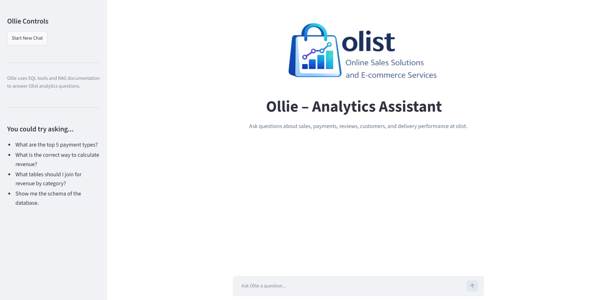
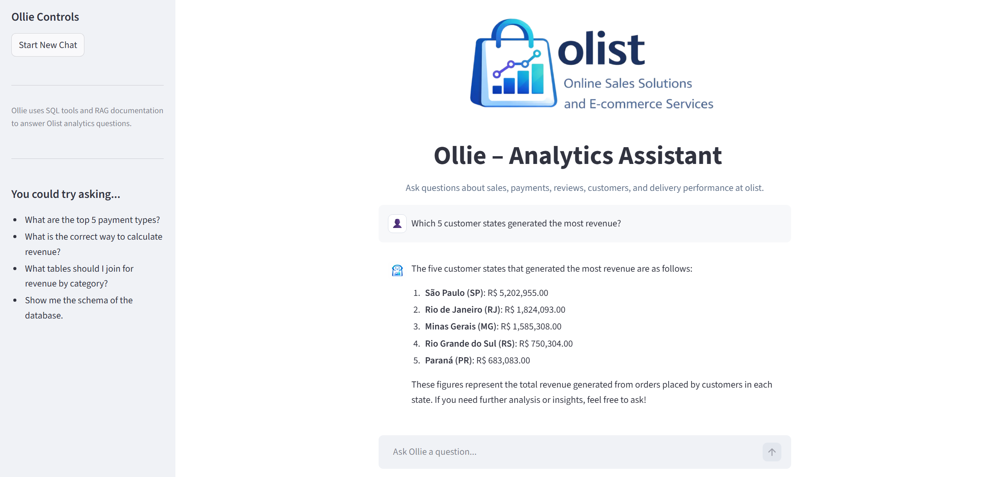
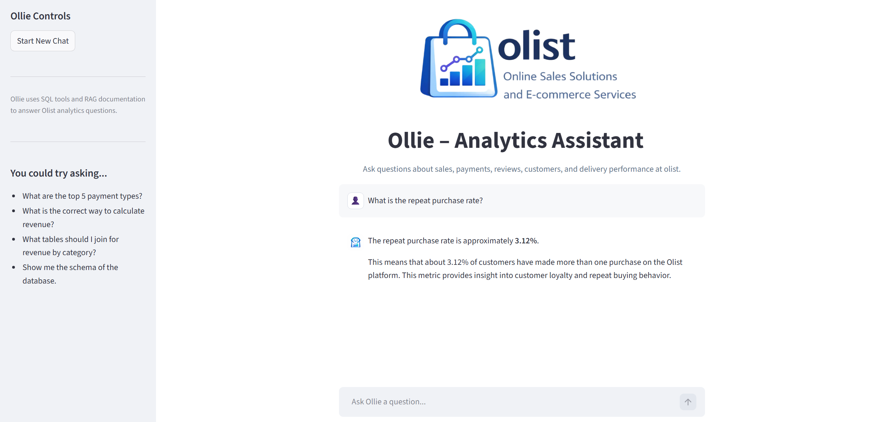

# Ollie SQL Analytics Agent

Ollie is an AI-powered SQL analytics agent that translates natural language business questions into SQL queries, retrieves insights from a database, and uses RAG documentation to ground responses in business context.

The project was built for **BSAN 400: GenAI for Business Insight** and demonstrates how AI agents can support business analytics workflows by combining a conversational interface, database tools, and retrieval-augmented generation.

---

## Project Overview

Business users often need answers from data but may not know SQL or may not know which tables, joins, or metric definitions to use. Ollie helps bridge that gap by allowing users to ask questions in plain English and receive data-backed answers with business-friendly explanations.

Ollie is built around the **Olist Brazilian E-Commerce dataset**, which includes information about orders, customers, products, sellers, payments, reviews, and delivery performance.

---

## Key Features

- **Natural language analytics interface**  
  Users can ask business questions without writing SQL.

- **SQL query generation and execution**  
  Ollie can generate SQL queries, validate them, and run them against a SQLite database.

- **Tool-based agent architecture**  
  Ollie uses LangChain tools to inspect the database schema, validate SQL, and execute queries safely.

- **RAG-grounded responses**  
  Ollie uses project documentation such as a data dictionary, business rules, and SQL safety guidelines to provide more reliable answers.

- **Streamlit user interface**  
  A clean web app interface allows users to interact with Ollie through a simple chat experience.

---

## Example Questions

Users can ask Ollie questions such as:

- What is the correct way to calculate total revenue?
- What are the top 5 payment types in the Olist database?
- What tables should I join to calculate revenue by product category?
- Which product categories drive the most revenue?
- How should SQL queries be written safely in this project?

---

## Demo

### Ollie Interface



### Revenue Analysis


### Repeat Purchase Analysis


---

## Tech Stack

- Python
- Streamlit
- OpenAI API
- LangChain
- FAISS
- SQLite
- Pandas

---

## Project Architecture

```text
User
  ↓
Streamlit Interface
  ↓
RAG Retrieval (FAISS)
  ↓
Retrieved Business / Data Context
  ↓
LangChain Agent
  ↓
Schema Inspection → SQL Generation → Validation → Execution
  ↓
SQLite Database
  ↓
Data-Backed Business Response

```

### Data and RAG Build Pipelines

Both the structured database and RAG knowledge layer can be rebuilt from source.

```text
7 Olist CSV files
      ↓
build_olist_db.py
      ↓
SQLite Database
      ↓
tool_files/olist.db

Project Documentation
      ↓
build_faiss_index.py
      ↓
Text Chunking + OpenAI Embeddings
      ↓
FAISS Vector Index
```

---

## Reliability & Evaluation

Ollie was tested using a 10-question evaluation set covering basic SQL queries, aggregations, multi-table joins, business-rule adherence, date calculations, customer-level metrics, ambiguous requests, and unsupported metrics.

The initial evaluation passed 5 of 10 cases. The failed cases exposed several useful reliability issues:

- inconsistent use of the project's defined revenue metric
- unnecessary clarification for otherwise answerable questions
- incorrect SQLite timestamp arithmetic
- incorrect customer-level aggregation for repeat-purchase analysis
- failure to clarify genuinely ambiguous business requests

Targeted improvements were then made to Ollie's analytical rules and clarification behavior. All five observed failure cases passed follow-up testing.

Examples of verified results include:

- **Total orders:** 99,441
- **Total revenue (GMV):** R$ 13,591,640.00
- **Average delivery time:** 12.56 days
- **Repeat purchase rate:** 3.12%

The evaluation showed that successful SQL execution alone does not guarantee analytical correctness; metric definitions, aggregation grain, database-specific SQL behavior, and user intent also need to be handled correctly.

---

## Safeguards & Limitations

- Ollie is restricted to read-only analytical SQL and supports `SELECT` queries and read-only CTEs.
- Generated SQL is passed through a validation tool before database execution.
- The agent can inspect the live SQLite schema rather than relying only on remembered table or column names.
- RAG provides business and SQL context, but retrieval does not guarantee that every generated query will be semantically correct.
- Ollie can only calculate metrics supported by the available Olist data. For example, profit margin cannot be calculated reliably because product cost / COGS data is not available.
- The project is an applied analytics-agent prototype rather than a production enterprise data system.

---

## Running the Project

The project was tested with **Python 3.12**.

Install the project dependencies:

```bash
pip install -r requirements.txt
```

Rebuild the SQLite database from the seven Olist CSV files:

```bash
python build_olist_db.py
```

Rebuild the FAISS knowledge index from the project documentation:

```bash
python build_faiss_index.py
```

Run the Streamlit application:

```bash
streamlit run app.py
```

Local development uses an `OPENAI_API_KEY` environment variable. The deployed Streamlit application uses Streamlit Secrets so API credentials are not stored in the repository.
